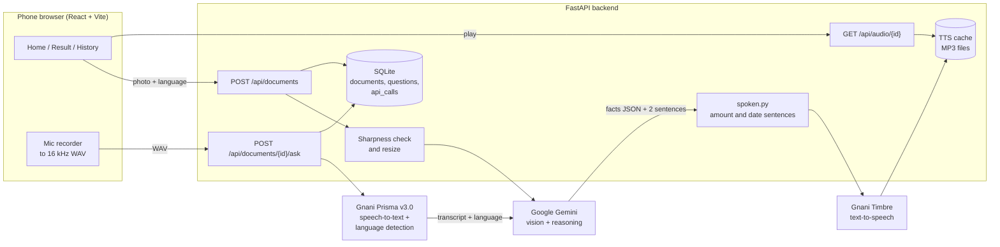
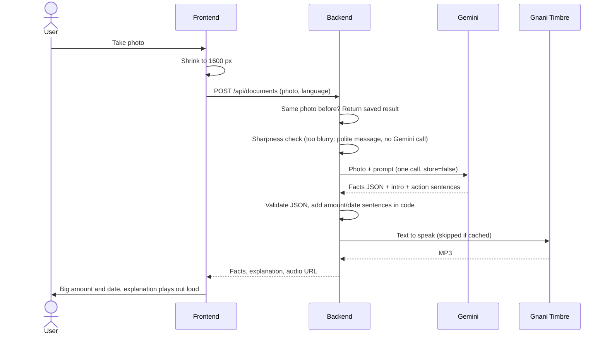

# Odhu (ಓದು)

*Odhu* means "read" in Kannada. Odhu helps elderly people understand bills and official
letters. You take a photo of an electricity bill, a bank letter or SMS, or a government notice,
and Odhu explains it **out loud** in simple **Kannada, Hindi or English**. Then you can ask
follow-up questions by voice ("When do I have to pay?") and hear the answer.

Built for Gnani AI's Great Indian AI Internship Challenge, using **Gnani Prisma** (speech-to-text)
and **Gnani Timbre** (text-to-speech), with **Google Gemini** for reading the photo.

## Features

- **Photo to spoken explanation** in 2-3 short sentences, with the amount and due date shown
  very large on screen ("7 days left" badge, red when the date is close or has passed).
- **Voice questions:** tap the mic, speak, tap again. The answer is spoken back and shown as a chat.
- **Three languages** for both the screens and the voice: Kannada, Hindi, English.
- **Hear any document in any language:** a "Hear it in" switch on every document. An older
  document opens in the language chosen on Home; other languages are made from the saved facts
  once, then reused for free.
- **Speak in any language:** Gnani Prisma v3.0 detects whether a question was asked in Kannada,
  Hindi or English, and the answer comes back in that same language.
- **Made for elderly users:** large text and buttons, high contrast, one main action per
  screen, a large-text mode ("A+"), and gentle animations that turn off with the phone's
  reduce-motion setting.
- **Honest when unsure:** a blurry photo gets a polite "please take a clearer photo", and a
  photo that was only partly readable comes with "please check the amount and date on the paper".
- **History** of everything scanned, including the questions asked.

## Never inventing amounts or dates

This was the most important design rule, so it's enforced in code, not just in the prompt:

| Risk | What Odhu does |
| --- | --- |
| A very blurry photo, where the LLM "reads" invented values | A sharpness check (edge detection) rejects the photo before Gemini is called |
| A borderline photo | Gemini must rate legibility *before* extracting anything; low confidence gets "clearer photo please" |
| The LLM turns 2,460 into the words for 2,260 | The LLM never says amounts or dates. Code adds those sentences from the extracted numbers (`app/spoken.py`) |
| An answer mentions a made-up ₹ amount | Every ₹ amount in an answer is checked against the document; if one isn't there, the answer is replaced with "not in this paper" |
| The LLM returns malformed or extra fields | Its JSON is validated with pydantic (`extra="forbid"`); a bad answer is an error, never shown |
| TTS misreads numbers ("31ರೊಳಗೆ") | Dates are spoken from hand-checked word tables, and amounts as "₹2,460", which Timbre reads correctly. Both were checked by speaking and transcribing back |

## Architecture



What happens when a photo is scanned:



### Repo layout

```
backend/
  app/
    main.py              FastAPI app; also serves the built frontend
    config.py            all settings, read from .env
    db.py                SQLite tables (documents, explanations, questions, api_calls)
    schemas.py           pydantic models: what the LLM must return, what the API sends
    spoken.py            amount and date sentences built in code; ₹-amount checker
    messages.py          fixed polite messages ("clearer photo please", ...)
    usage.py             counts Gnani credits and Gemini calls
    routes/              documents.py, questions.py, audio.py
    services/
      gnani.py           the only file that talks to Gnani (STT + TTS)
      llm.py             the only file that talks to Gemini, behind an LLMProvider interface
      audio_cache.py     TTS cache on disk, keyed by a hash of (text, voice, language, speed)
      image_check.py     sharpness check and resize
  tests/                 pytest; Gnani and Gemini are always faked
frontend/
  src/
    App.tsx              picks the screen from the URL hash (#/, #/history, #/doc/<id>)
    api.ts               calls to the backend
    i18n.ts              every on-screen text in Kannada, Hindi, English
    audio/               shared audio player, recorder, WAV converter
    screens/             Home, Loading, Result, History
    components/          buttons, top bar, mic button, icons
samples/                 fake bills and letters (HTML + PNG) and their correct answers
scripts/                 smoke_test.py, check_extraction.py
Dockerfile, render.yaml  deployment (see "Deploying")
```

## Setup

You need Python 3.11+, [uv](https://docs.astral.sh/uv/), Node 20+, a
[Gnani API key](https://app.gnani.ai/voice/) and a [Gemini API key](https://aistudio.google.com/apikey).

```bash
# 1. Keys
cp .env.example .env              # then fill in GNANI_API_KEY and GEMINI_API_KEY

# 2. Backend
cd backend
uv sync
uv run uvicorn app.main:app --reload          # http://localhost:8000/api/health

# 3. Frontend (second terminal)
cd frontend
npm install
npm run dev                                   # open the URL it prints
```

Settings in `.env` (see `.env.example` for comments):

| Variable | Default | Meaning |
| --- | --- | --- |
| `GNANI_API_KEY` | (required) | Sent as the `X-API-Key-ID` header |
| `GEMINI_API_KEY` | (required) | Gemini API key |
| `GEMINI_MODEL` | `gemini-3.5-flash-lite` | Main model |
| `GEMINI_FALLBACK_MODELS` | `gemini-3.1-flash-lite,gemini-3-flash-preview,gemini-3.6-flash` | Tried in order if the main one fails; each has its own free quota |
| `TTS_VOICE` | `Shivani` | Any Timbre v3.0 voice (all speak Kannada, Hindi and English) |
| `TTS_SPEED` | `0.9` | 0.85 to 1.15; slightly slow is easier for elderly listeners |
| `GNANI_CREDIT_BUDGET` | `5000` | Credits left when this database started counting |

## Running the demo on a phone

Phone browsers only allow the microphone on **https** pages. The easiest way is to run one
server on your laptop and open it through a free HTTPS tunnel:

```bash
cd frontend && npm run build                  # the backend now serves the app too
cd ../backend && uv run uvicorn app.main:app  # app + API on http://localhost:8000

brew install cloudflared                      # once
cloudflared tunnel --url http://localhost:8000
```

Open the `https://….trycloudflare.com` address it prints on the phone. Anyone with the link
can use the app (and your credits) while the tunnel runs, so stop it with Ctrl+C after the demo.

## Deploying (Render)

The repo includes a `Dockerfile` (builds the frontend and runs everything as one server) and a
`render.yaml` Blueprint. Once it's set up, **every `git push` to `main` redeploys automatically**.

One-time setup:

1. Sign in at https://render.com with your GitHub account.
2. **New → Blueprint**, pick this repository, and click **Apply**.
3. When asked, fill in `GNANI_API_KEY`, `GEMINI_API_KEY`, and `GNANI_CREDIT_BUDGET` (the credits
   left on your Gnani dashboard).
4. Wait for the first build (a few minutes). The app is then live at `https://odhu-XXXX.onrender.com`,
   with HTTPS, so the microphone works on phones.

Things to know about the free plan:

- It **sleeps after 15 minutes** without visitors; the next visit takes about a minute to wake it.
  Open the link a minute before a demo.
- History and cached audio are **reset on every redeploy or restart** (the free plan has no
  permanent disk). Scanning works the same; repeated sentences just get spoken (and paid for) again.
- The link is public: anyone who has it can use your Gnani credits and Gemini quota.

To test the same image on your laptop: `docker build -t odhu . && docker run -p 8000:8000 --env-file .env odhu`.

## Testing

```bash
cd backend
uv run pytest                                 # 93 tests; Gnani and Gemini are faked, no credits used
uv run python ../scripts/check_extraction.py  # Gemini only: reads every sample, compares to samples/expected.json
uv run python ../scripts/smoke_test.py        # real end-to-end: TTS, STT, Gemini read + answer (about 3 Gnani credits)

cd ../frontend
npm run lint && npm run build
```

`check_extraction.py` takes options: `04 06` runs only those samples, and `--hindi` or
`--english` writes the explanations in that language.

## Keeping within credits and quotas

- **Gnani (5,000 credits):** TTS output is cached on disk, so a sentence is only paid for
  once, including the fixed messages. Every call is logged with its duration;
  `GET /api/usage` shows totals and an estimate of credits left.
- **Gemini (free tier):** one call per scan, since facts and sentences come together; the
  same photo or the same question is never sent twice; hopelessly blurry photos are rejected
  before calling Gemini; photos are shrunk first; and three fallback models each have their
  own daily quota.

## API

| Method | Path | What it does |
| --- | --- | --- |
| `POST` | `/api/documents` | Form fields `image` and `language` (`kn-IN`, `hi-IN` or `en-IN`). Returns facts, explanation, audio URL |
| `GET` | `/api/documents` | History, newest first, with questions |
| `GET` | `/api/documents/{id}` | One document with its questions |
| `POST` | `/api/documents/{id}/ask` | Form fields `audio` (WAV/MP3/OGG/FLAC/AAC/M4A, up to 30 s) and optional `language` (the listening language, a hint). Returns transcript, detected language, answer, audio URL |
| `POST` | `/api/documents/{id}/explanations` | JSON `{"language": "en-IN"}`. The explanation in that language, made once from the saved facts |
| `GET` | `/api/audio/{id}` | A cached MP3 |
| `GET` | `/api/usage` | Gnani and Gemini call counts |

Interactive API docs are at http://localhost:8000/docs while the backend runs.

## Privacy and safety

- Photos are **not stored**. Only the extracted facts and explanation are saved, in a local SQLite file.
- Gemini is called with `store: false`, so Google doesn't keep the requests.
- `.env` is git-ignored. Never commit real keys.
- All sample documents are fake: invented companies, names and account numbers, and no real
  Aadhaar or PAN numbers.

## Troubleshooting

| Problem | Fix |
| --- | --- |
| "Service is busy" on every scan | Your Gemini free quota may be used up for today (it resets at midnight Pacific time). Check `GET /api/usage` and https://ai.dev/rate-limit |
| The mic says recording doesn't work | Open the app over https (see the phone demo section) or on `localhost` |
| No sound after scanning on iPhone | Tap the pulsing Listen button; iOS sometimes blocks sound that wasn't started by a tap |
| Port 5173 or 8000 is in use | `npm run dev -- --port 3000`, or stop the old server (`lsof -nP -iTCP:8000 -sTCP:LISTEN`) |
| Changed a database table | Delete `backend/data/odhu.db` and restart; tables are recreated automatically |
